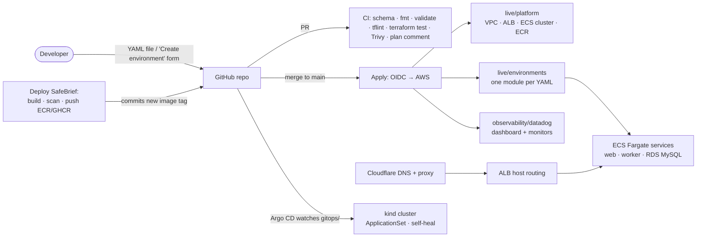

# Launchpad — a small Internal Developer Platform on AWS

**Developers get a running environment by adding one YAML file. Getting a new environment goes from a ticket and a few days of waiting to a pull request and a few minutes.**

Launchpad is a portfolio-sized Internal Developer Platform. It runs a real Laravel app ([SafeBrief](https://github.com/dfhasan/safebrief)) on AWS ECS Fargate. It's built with Terraform, GitHub Actions (OIDC, no stored keys), GitOps with Argo CD, Datadog monitoring as code and Cloudflare at the edge.

```yaml
# environments/safebrief-pr-42.yaml  ← this is the whole request a developer makes
name: safebrief-pr-42
app: safebrief
team: safety
owner: dfhasan
image_tag: "3f9c2a1b7e01"
expires: 2026-10-20        # the reaper deletes it after this date
```

Open a PR → CI checks it against the schema, runs offline tests and posts the `terraform plan` → merge → the environment is live. Delete the file → the environment is destroyed.

---

## Architecture



| Layer | Path | Owner | Changes |
|---|---|---|---|
| Bootstrap | `bootstrap/` | platform (once) | S3 state + native S3 locking, GitHub OIDC provider, plan / apply / build roles |
| Platform | `live/platform` | platform team | VPC, shared ALB, ECS cluster (Fargate + Spot), ECR |
| Environments | `live/environments` + `environments/*.yaml` | **developers** | ECS service(s), optional RDS, IAM, logs, autoscaling, DNS |
| Observability | `observability/datadog` | platform team | Dashboard + 5xx, latency and health monitors for every environment |
| GitOps | `gitops/` | developers | Kustomize overlays synced by an Argo CD ApplicationSet |

### Mapping to the Senior Platform Engineer role

| Requirement | Where it lives |
|---|---|
| Internal developer platform, self-service, golden paths | `environments/*.yaml` + JSON Schema, *Create environment* workflow, reusable `_build-laravel.yml` |
| Environment provisioning "days → minutes" | Merge a YAML file → `apply.yml` |
| Terraform modules + state management | `modules/*`, S3 backend with `use_lockfile`, layered states, `terraform_remote_state` |
| AWS: VPC, ECS, RDS, IAM, ALB, ECR, SSM, Secrets Manager | `modules/network`, `platform`, `service`, `database` |
| CI/CD with GitHub Actions | `.github/workflows/*`, OIDC roles scoped by branch / environment |
| GitOps, declarative infra | Git is the source of truth for both ECS (Terraform) and Kubernetes (Argo CD, self-heal) |
| Observability with Datadog | `observability/datadog` + optional agent sidecar (`DATADOG_API_KEY_SSM_NAME`) |
| Security and compliance in the tooling | Keyless CI, least-privilege task roles, secrets only in SSM / Secrets Manager, schema blocks secrets in YAML, Trivy on IaC and images, SG chaining, encrypted state and RDS |
| Cost awareness | Fargate Spot by default, no NAT, SQLite previews, TTL reaper, destroy-all workflow |
| Spacelift, Cloudflare (nice to have) | `.spacelift/config.yml`, `modules/dns` + ALB locked to Cloudflare IPs |
| Tested IaC | `live/environments/tests/*.tftest.hcl`: mocked providers, runs with no cloud account |

---

## Run it

### 0. Offline (no accounts needed)
```sh
make check     # fmt, validate, terraform test (mocked AWS), schema check, kustomize + kubeconform
```

### 1. Local GitOps (free, needs Docker + kind + kubectl)
```sh
git push -u origin main                          # Argo CD pulls from GitHub
scripts/kind-up.sh --build ../safebrief          # cluster + Argo CD + ApplicationSet (+ local image)
# Argo CD: https://localhost:8443 · dev: http://localhost:8080 · prod: http://localhost:8081
```

### 2. AWS (use a new account on the AWS Free plan: credits, no bill unless you upgrade)
```sh
cd bootstrap
terraform init && terraform apply -var github_repo=dfhasan/launchpad
```
In GitHub → Settings → *Secrets and variables → Actions → Variables*, add:

| Variable | Value |
|---|---|
| `AWS_REGION` | `eu-central-1` |
| `TF_STATE_BUCKET` | output `state_bucket` |
| `AWS_PLAN_ROLE_ARN` / `AWS_APPLY_ROLE_ARN` / `AWS_BUILD_ROLE_ARN` | outputs |

Create a GitHub **environment** called `production` (Settings → Environments), restricted to `main`. Then:
1. Run **Apply** → creates the platform and `safebrief-dev`.
2. Run **Deploy SafeBrief** → builds the image, pushes it, commits the tag and applies again.
3. Open the ALB URL from the Apply summary.
4. When you're done for the day: **Destroy everything** (type `destroy`).

Optional:
- **Cloudflare:** set `BASE_DOMAIN`, `CLOUDFLARE_ZONE_ID` and secret `CLOUDFLARE_API_TOKEN`. Each environment becomes `https://<name>.<domain>`.
- **Datadog:** set `DATADOG_API_URL` and secrets `DD_API_KEY` / `DD_APP_KEY`.

### Cost (eu-central-1, approximate)
| Running | ~per day |
|---|---|
| ALB | $0.55 |
| 1 × small Fargate Spot task | $0.10 |
| RDS db.t4g.micro (only with `database: mysql`) | $0.40 |
| Public IPv4 addresses (ALB + tasks, $0.005/h each) | ~$0.36 |
| No NAT gateway, Container Insights off, 7-day log retention | $0 |

---

## Design decisions
- [ADR-0001: no NAT gateway](docs/adr/0001-no-nat.md)
- [ADR-0002: YAML + Terraform `for_each` as the platform API](docs/adr/0002-yaml-as-platform-api.md)
- [ADR-0003: CI permissions with OIDC](docs/adr/0003-ci-permissions.md)
- [Runbook: high 5xx](docs/runbooks/high-5xx.md)

## Next steps
- A Backstage / Port catalog that reads `environments/*.yaml`
- EKS + Argo CD in AWS with External Secrets Operator
- Per-PR preview environments created automatically from the app repo
- OPA / Conftest policies on the plan JSON (cost limits per team, required tags)
